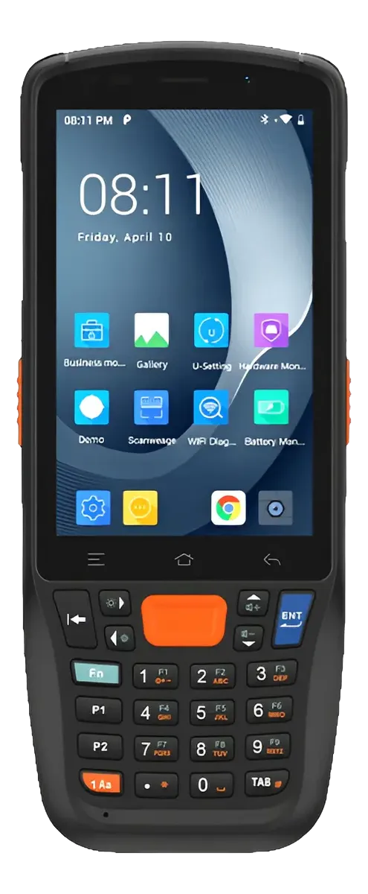
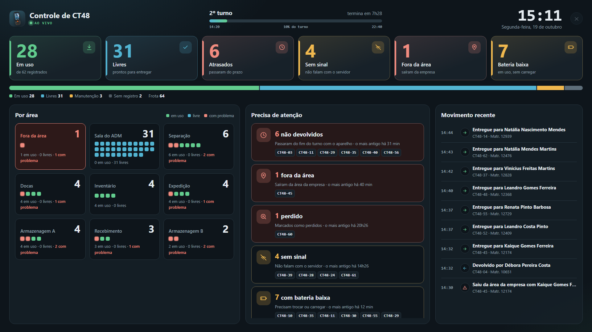
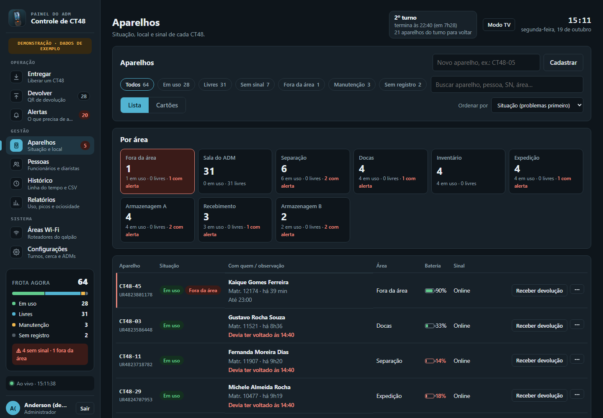
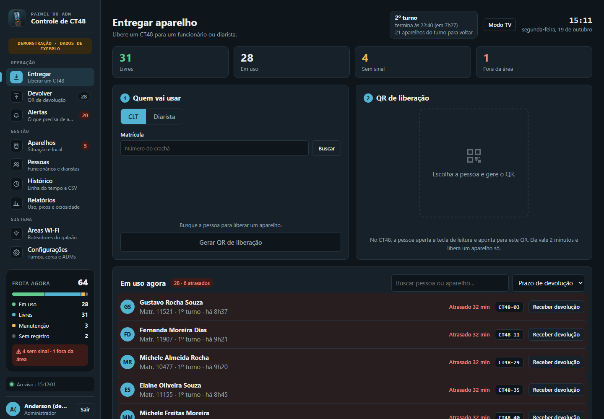
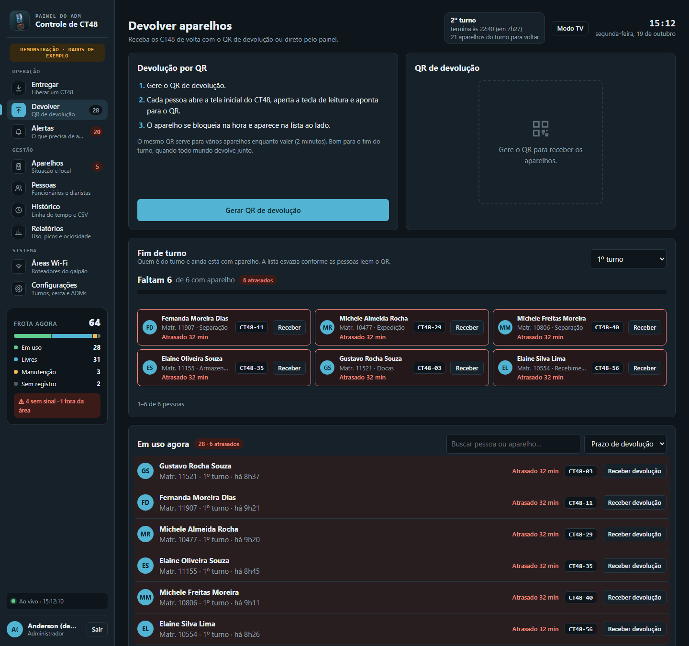
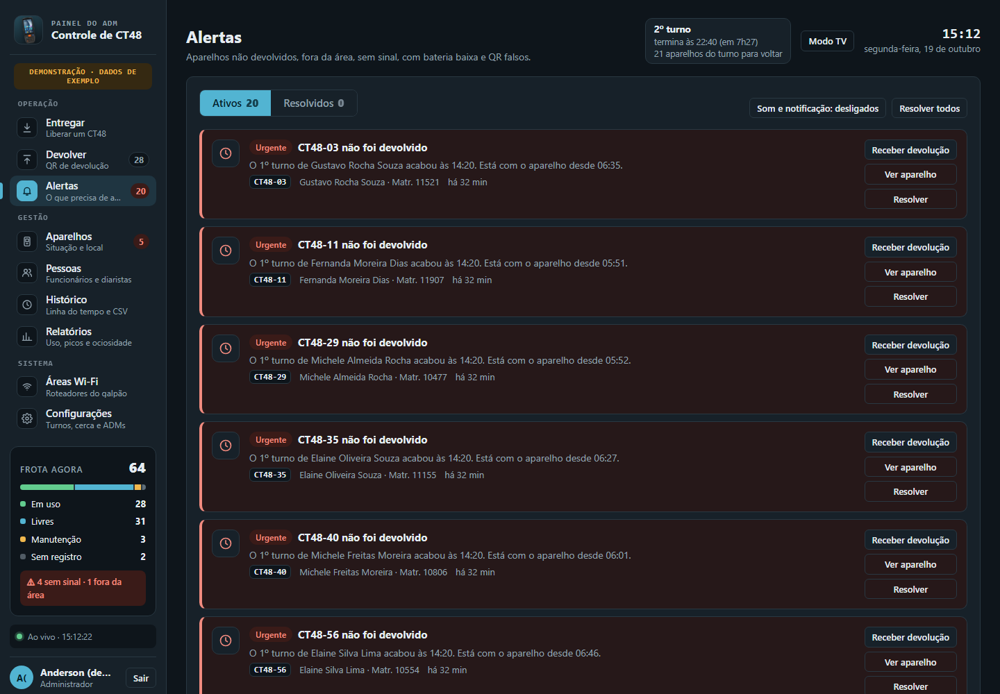
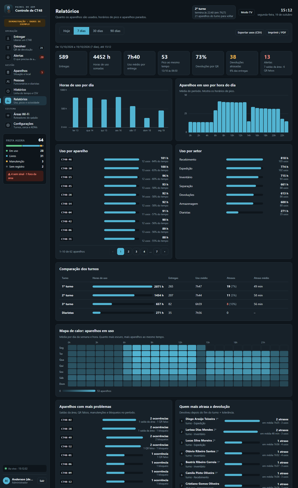
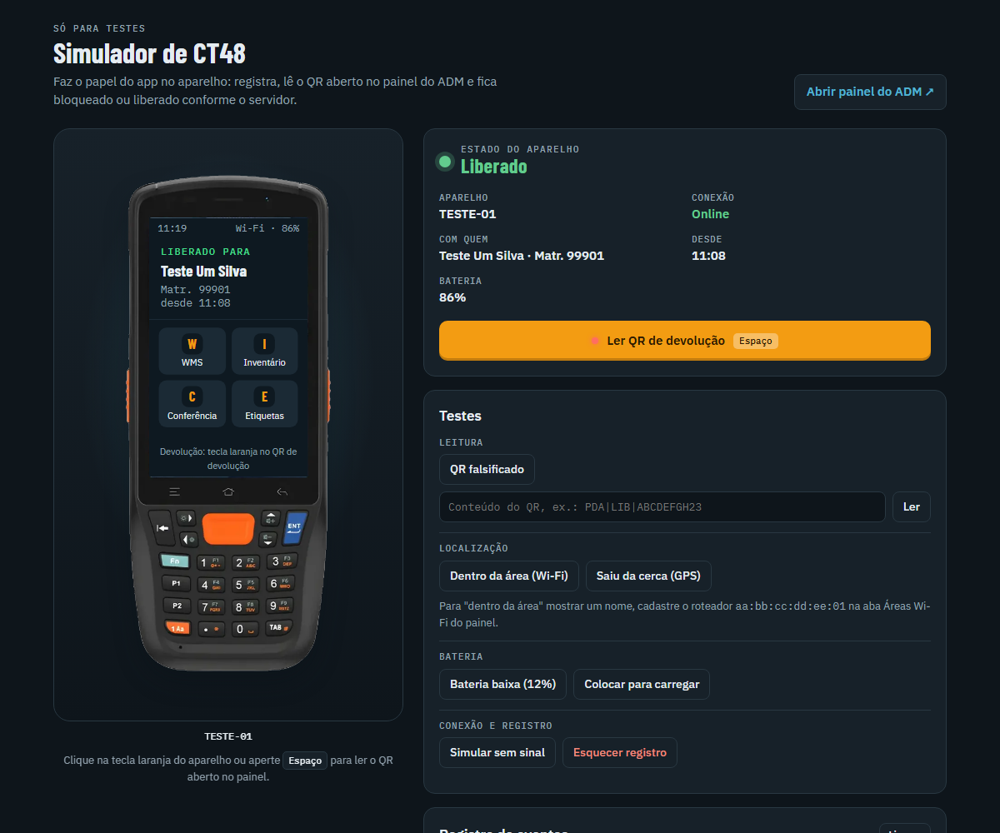
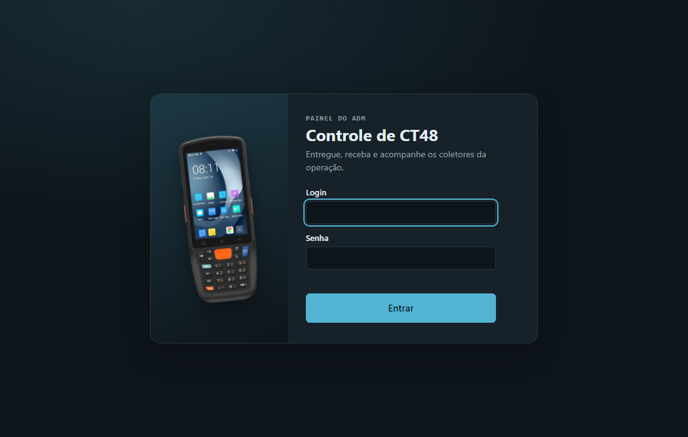
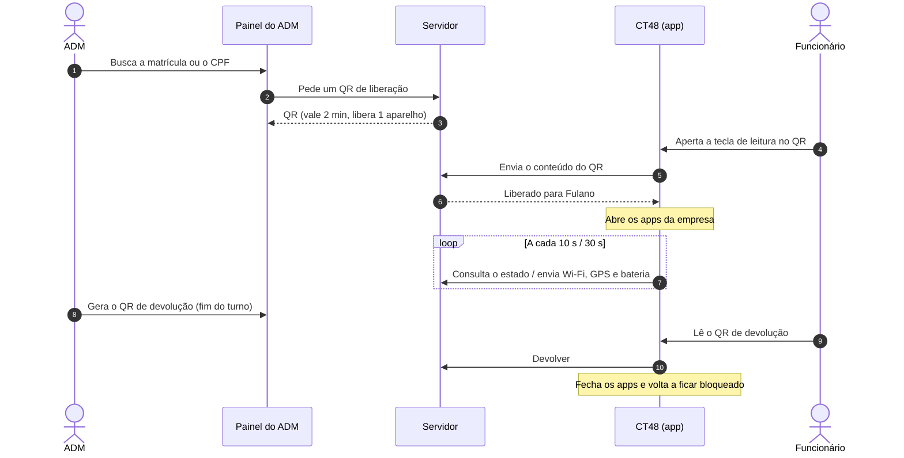

<div align="center">



# Controle de CT48

**Entrega, devolução e rastreio dos coletores Urovo CT48 da operação, com QR Code.**

O aparelho fica bloqueado até o ADM liberar. Cada liberação vincula o CT48 (número de série) a quem está com ele,<br>
e o painel mostra em tempo real onde está cada aparelho, com quem e o que precisa de atenção.


</div>

<p align="center">
  
  <br><sub><b>Modo TV</b> para um monitor na sala do ADM, aqui com a demonstração de 64 CT48 (dados fictícios)</sub>
</p>

---

## ✨ O que ele faz

| | |
|---|---|
| 🔐 **Bloqueio por padrão** | O CT48 fica em modo quiosque. Só abre os apps da empresa depois de ler o QR de liberação. |
| 📲 **Entrega com QR** | O ADM busca o funcionário (matrícula) ou o diarista (CPF) e gera um QR que vale 2 minutos e libera **um** aparelho. O painel **sugere qual CT48 entregar** (o livre com mais bateria). |
| ↩️ **Devolução com QR** | Um único QR de devolução bloqueia todos os aparelhos que o lerem. O **fim de turno guiado** mostra quem do turno ainda está com aparelho. |
| 🚨 **Alertas** | Não devolvido depois do turno, fora da área, sem sinal, bateria baixa, perdido ou QR falso. Com som e notificação no navegador. |
| 📺 **Modo TV** | Tela cheia para monitor: indicadores grandes, áreas com um ponto por CT48, alertas agrupados e movimento recente, ao vivo. |
| 📍 **Localização** | Área pelo roteador Wi-Fi do galpão (mais preciso lá dentro) e GPS com cerca virtual. Quadro com quantos CT48 há em cada área. |
| 🗂️ **Feito para frota grande** | Aparelhos em lista ou cartões, ordenação, filtros e páginas (1, 2, 3…) em todas as listas longas. |
| 👥 **Pessoas** | Quem está com aparelho, histórico, atrasos de cada um, bloqueio de quem perdeu ou quebrou e importação da base do RH em CSV. |
| 📊 **Relatórios** | Entregas, horas de uso, pico, uso por hora, comparação dos turnos, mapa de calor, aparelhos com mais problemas e quem mais atrasa. Exporta CSV e PDF. |
| 🛠️ **Manutenção** | Marca o CT48 como em manutenção, quebrado ou perdido: ele não pode ser liberado até voltar. |
| 🧪 **Demonstração e simulador** | `npm run demo` abre o painel com 64 CT48 e 30 dias de uso fictícios; o simulador faz o papel do aparelho no navegador. |

## 🖥️ Telas

<table>
  <tr>
    <td width="50%"><p align="center"><b>Aparelhos</b>: lista com situação, bateria e sinal, e o quadro por área</p></td>
    <td width="50%"><p align="center"><b>Entregar</b>: busca a pessoa, gera o QR e acompanha quem está em uso</p></td>
  </tr>
  <tr>
    <td width="50%"><p align="center"><b>Devolver</b>: QR de devolução e fim de turno guiado</p></td>
    <td width="50%"><p align="center"><b>Alertas</b>: o que precisa de atenção, do mais urgente ao aviso</p></td>
  </tr>
  <tr>
    <td width="50%"><p align="center"><b>Relatórios</b>: uso, picos, turnos, mapa de calor e atrasos</p></td>
    <td width="50%"><p align="center"><b>Simulador</b>: bancada de testes sem o aparelho</p><p align="center"><b>Login</b> do painel do ADM</p></td>
  </tr>
</table>

## 🔄 Como funciona



- O QR leva só um código aleatório. Nenhum dado pessoal sai do servidor.
- Sem sinal, o aparelho mantém o último estado para não travar quem está trabalhando.
- O ADM também pode receber a devolução ou bloquear o aparelho na hora, direto pelo painel.

## 🧱 Tecnologias

- **App do CT48:** Android nativo em Kotlin, Device Owner + modo quiosque (lock task), leitura pelo `ScanManager` da Urovo, serviço em primeiro plano para estado, posição e bateria.
- **Servidor:** Node.js 22 + Express 5, SQLite nativo do Node (`node:sqlite`), sem ORM. Única outra dependência: `qrcode`.
- **Painel:** HTML, CSS e JavaScript puros, sem framework e sem nada carregado de fora (política de segurança de conteúdo restrita). Tema claro e escuro.

## 🚀 Como rodar

### Ver funcionando em 1 minuto

```sh
cd servidor
npm install
npm run demo
```

Abra `http://localhost:3200` e entre com `demo` / `demo1234`: são 64 CT48, ~180 funcionários e 30 dias de uso, tudo fictício, num banco separado. O Modo TV fica em `http://localhost:3200/#tv`.

### Servidor e painel

Precisa do **Node.js 22.13 ou mais novo**.

```sh
cd servidor
npm install
copy config.exemplo.json config.json                 # ajuste a porta
npm run importar-rh -- exemplos/funcionarios.csv     # ou importe pelo painel, em Pessoas
npm run criar-adm
npm start
```

Abra `http://localhost:3000` (ou a porta do `config.json`). Para usar outra porta sem editar o arquivo: `PORTA=3100 npm start`.

> **Demonstração:** `npm run demo` gera um banco de exemplo **separado** (`dados/demo.db`) com 64 CT48, cerca de 180 funcionários nos 3 turnos, 25 diaristas e 30 dias de uso, e abre o painel em `http://localhost:3200` (login `demo`, senha `demo1234`). O banco real não é tocado. Para abrir de novo sem gerar outra vez: `npm run demo:abrir`. Todos os nomes e CPFs são fictícios.

> **Simulador:** `npm run simulador` sobe o servidor com um CT48 de mentira em `/simulador`. Ele tem uma rota que entrega o QR aberto sem leitura física, então **nunca use em produção**: lá é sempre `npm start`.

### App do CT48

1. Instale o [Android Studio](https://developer.android.com/studio) e abra a pasta `app-ct48/`.
2. Gere e instale o app no CT48 (Run ▶ com o aparelho no cabo USB e a depuração USB ligada).
3. Torne o app administrador do aparelho (Device Owner). O aparelho não pode ter conta Google configurada:
   ```sh
   adb shell dpm set-device-owner br.com.pda.ct48/.AdminReceiver
   ```
4. No painel, seção **Aparelhos**, cadastre um nome (ex.: CT48-01). No CT48, digite o endereço do servidor (`http://<IP do servidor>:3000`) e o código de registro que aparece no cartão.

O CT48 precisa estar na mesma rede do servidor. No Windows, libere a porta do servidor no firewall.

**Leitor (Urovo):** com a tela inicial do app aberta, o scanner vai para o modo *Intent* pelo `ScanManager` e as leituras chegam pelo broadcast `android.intent.ACTION_DECODE_DATA` (campo `barcode_string`). Ao sair da tela, o app devolve o modo anterior, para o WMS continuar lendo como teclado. Se o scanner estiver em modo teclado, o app também entende a leitura.

**Build de teste (debug):** um toque longo no nome do aparelho, na tela de bloqueio, abre um menu para digitar o conteúdo de um QR e para remover o Device Owner antes de desinstalar. Nesse build, o reset de fábrica e o modo seguro **não** são bloqueados. Em uso real, instale o build *release*.

## ⚙️ Painel do ADM

Seções: **Entregar, Devolver, Alertas, Aparelhos, Pessoas, Histórico, Relatórios, Áreas Wi-Fi e Configurações**. As teclas `1` a `9` trocam de seção, e o endereço guarda a seção aberta (`/#relatorios`).

Feito para frota grande: listas com páginas (1, 2, 3…), Aparelhos em **lista ou cartões** com ordenação e **quadro por área**, **fim de turno guiado** (quem do turno ainda está com aparelho), **sugestão de qual CT48 entregar** (o livre com mais bateria), turno atual no topo e **Modo TV** (`/#tv`) para um monitor na sala do ADM. Os relatórios comparam os turnos e mostram mapa de calor, aparelhos com mais problemas e quem mais atrasa a devolução.

Em **Configurações** ficam os turnos (o nome tem que ser igual ao da coluna `turno` do CSV do RH, é ele que diz quando o aparelho devia ter voltado), os limites dos alertas, a validade do QR, os apps liberados no CT48, a cerca virtual e os ADMs.

O `config.json` traz os valores iniciais. O que for salvo pelo painel fica no banco e vale por cima do arquivo. `porta`, `intervaloEstadoSegundos` e `intervaloPosicaoSegundos` são só pelo arquivo.

## 📁 Estrutura

```
PDA/
├── app-ct48/                 App Android (Kotlin) que roda no CT48
│   └── app/src/main/
│       ├── java/br/com/pda/ct48/
│       │   ├── BloqueioActivity.kt   Tela inicial: bloqueio + leitura do QR, ou apps da empresa quando liberado
│       │   ├── RegistroActivity.kt   Primeiro uso: endereço do servidor e código de registro
│       │   ├── MonitorService.kt     Consulta o estado, aplica o bloqueio, envia posição e bateria
│       │   ├── Scanner.kt            Leitor da Urovo (broadcast do ScanManager)
│       │   ├── Kiosk.kt              Modo quiosque (Device Owner)
│       │   └── Api.kt, Estado.kt, Prefs.kt, AdminReceiver.kt
│       └── res/                      Telas, textos e permissões de admin
│
├── servidor/                 Servidor (Node.js + SQLite) e painel web do ADM
│   ├── src/
│   │   ├── index.js          Sobe o servidor e liga as rotas
│   │   ├── rotas/            API por assunto: sessao, entregas, aparelhos, pessoas,
│   │   │                     monitoramento, sistema, dispositivo (app do CT48) e simulador
│   │   ├── db.js             Banco SQLite: tabelas e histórico
│   │   ├── config.js         Configurações (config.json + o que foi salvo pelo painel)
│   │   ├── auth.js           Senhas, sessões do painel e tokens dos aparelhos
│   │   ├── middlewares.js    Exige ADM logado ou CT48 registrado
│   │   ├── pessoas.js        Funcionários, diaristas, turno e bloqueio
│   │   ├── aparelhos.js      Regras dos aparelhos
│   │   ├── alertas.js        Cálculo dos alertas
│   │   ├── relatorios.js     Sessões de uso e indicadores
│   │   ├── rh.js             Leitura do CSV do RH
│   │   └── util.js           Funções pequenas compartilhadas
│   ├── scripts/              Comandos: criar-adm, importar-rh
│   ├── public/               Painel: index.html, css/, js/ (uma seção por arquivo), img/
│   ├── simulador/            CT48 de mentira no navegador
│   ├── exemplos/             CSV de exemplo da base de RH (dados fictícios)
│   ├── config.exemplo.json   Modelo do config.json
│   └── dados/                Banco (ct48.db) e logs. Não vai para o git; faça backup
│
└── docs/
    ├── imagens/              Telas usadas neste README
    └── prototipo/            Protótipo HTML do começo do projeto (referência visual)
```

## 🔒 Segurança

- Senhas dos ADMs com `scrypt`; sessões do painel e tokens dos aparelhos guardados só como hash.
- Bloqueio de 5 minutos depois de 5 tentativas erradas de login ou de código de registro.
- QR com código aleatório, validade curta e uso único (liberação). QR falso é registrado e vira alerta.
- Cookie de sessão `HttpOnly` + `SameSite=Strict` e política de segurança de conteúdo (CSP) restrita no painel.
- O banco, os logs e o `config.json` ficam fora do repositório.

## 🗺️ Próximos passos

- [ ] Testar no CT48 real: leitura pelo scanner da Urovo, modo quiosque e tela de bloqueio voltando sozinha
- [ ] HTTPS no servidor (proxy reverso) e remover `usesCleartextTraffic` do app
- [ ] Backup automático do banco
- [ ] Testes automáticos do servidor (liberar, devolver, travas e alertas)
- [ ] Provisionamento em massa dos aparelhos (QR de provisionamento do Android ou a ferramenta de gestão da Urovo)
- [ ] Consulta direta à base do RH, se houver API ou banco acessível
- [ ] LGPD: aviso aos funcionários sobre localização e prazo de guarda do histórico
- [ ] Mapa do galpão com os aparelhos em cada área
